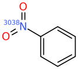
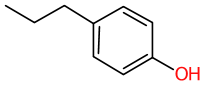

# Dicer Fragments

This directory distributes a compact collection of ChEMBL 37 fragments for
sidechain replacement and linker generation. Install the files with the normal
build, or extract them directly:

```shell
cd "$LILLYMOL_HOME/data/dicer_fragments"
tar -xJf dicer_fragments.tar.xz
```

The archive contains 21 textproto files and 603,938 fragments. Records in each
file are sorted by decreasing prevalence (`n`), with the complete record as a
deterministic tie breaker.

- `FRAG_1_1.textproto` through `FRAG_1_11.textproto` contain single-attachment
  fragments. The final number is the atom count.
- `FRAG_2_1.textproto` through `FRAG_2_10.textproto` contain two-attachment
  fragments (linkers). The final number is the number of bonds between
  attachment points, **not** the atom count. Every distributed linker also
  satisfies `nat <= 11`.

The `nat` field is the fragment atom count, `n` is its occurrence count, and
`par` identifies an example parent molecule. Fragment SMILES represent complete
molecules: a detached methyl group is therefore written as `[1CH4]`, becoming
CH3 when joined to another molecule.

## Attachment labels

The distribution no longer uses atom types at attachment points. Atom-typed
labels proved more confusing than helpful for this general-purpose collection.
Records use `iso: ATT`, with isotope **1** identifying attachment atoms; these
labels do not describe the atom that was across the broken bond. This changes
the isotope semantics from the previous distribution, so code expecting the
old atom-type isotope values must be adapted.

For example:

```text
iso: ATT smi: "[1CH4]" par: "CHEMBL153534" nat: 1 n: 2094241
iso: ATT smi: "[1OH2]" par: "CHEMBL503634" nat: 1 n: 1273580
iso: ATT smi: "[1NH3]" par: "CHEMBL405398" nat: 1 n: 764142
```

## Generating a larger or atom-typed collection

The full source collection was generated using the dicer rules in
[`contrib/bin/Makefile.collection`](../../contrib/bin/Makefile.collection).
Its dicer command is:

```shell
dicer -B proto -B nbamide -B brcb -B fragstat=chembl.fragstat \
  -B fragstatproto -k 3 -X 512 -I 1 -M 20 -M maxnr=11 -c \
  -T I=Cl -T Br=Cl -v chemblgO.smi > chembl.dicer.smi 2> chembl.dicer.log
mkdir -p chembl.dicer_fragments
dicer_to_topological_types -S chembl.dicer_fragments/DICER -z chembl.fragstat
```

The Makefile first prepares standardized organic molecules containing 5–50
atoms, from an intermediate collection allowing up to 70 atoms. Dicer permits
up to three cuts (`-k 3`), fragments up to 20 atoms (`-M 20`), and up to eleven
non-ring atoms (`-M maxnr=11`). It enables ring-to-chain bond cuts (`-B brcb`), preserves amide and amide-like
bonds (`-B nbamide`), and translates Br and I to Cl. These generation settings
produce a much larger source collection than the repository distributes:
7,384,077 records occupying about 641 MB across 35 files.

To keep the repository archive near its previous size, the distribution selects
**all fragments of at most eleven atoms**, with no prevalence cutoff. For
single-attachment files this selects sizes 1–11; linkers are filtered by the
record's `nat` field rather than by filename alone. Empty files are omitted,
`DICER_` filenames become `FRAG_`, and retained records are sorted by prevalence.
The selected text occupies about 44.85 MB before xz compression; the sorted
distribution archive is 5,051,360 bytes (about 5.05 MB), below the previous
6.10 MB archive.

The subset can be reproduced from the full ChEMBL output:

```shell
python3 "$LILLYMOL_HOME/data/dicer_fragments/build_distribution.py" \
  /path/to/chembl.dicer_fragments --max_atoms 11 \
  --output /tmp/dicer_fragments.tar.xz
```

To obtain more fragments, use `Makefile.collection` to generate your own full
collection, or choose your own dicer and distribution limits. In particular,
raising `--max_atoms` only retains larger fragments already present in the
source; generating fragments beyond its limits requires rerunning dicer.

If atom-typed attachment labels are useful for your application, start with the
Makefile command, **replace `-I 1` with `-I atype`**, and add an atom typing
specification such as `-P UST:AY`. This differentiates aromatic from aliphatic
atoms (`A`) and uses the heavy-halogen-compressed atomic number (`Y`). See
[Atom Typing in the dicer documentation](../../docs/Molecule_Tools/dicer.md#atom-typing)
and the [atom typing reference](../../docs/Molecule_Lib/atom_typing.md).
Keep a custom atom-typed collection separate from this distribution.

## Sidechain Replacement
Replacing a sidechain using the isotope-1 attachment markers is
straightforward. Imagine removing an existing Aniline Nitrogen and replacing it
with further Nitrogen substitued sidechains.

The reaction file might look like
```
name: "Aniline_plus_a"
scaffold {
  smarts: "[NH2]-c"
  remove_atom: 0
}
sidechain {
  id: 1
  smarts: "[>0NH>0]"
  join {
    a1: 1
    a2: 0
  }
}
```

and if we choose to add 3 atom sidechains, that could be done as
```
trxn -P Aniline_plus_a.rxn -Z aniline.smi FRAG_1_3.textproto
```
will generate molecules like



Note that the reaction did not specify a particular value for the isotope,
just ">0" so any of the fragments could be added.

Alternatively if we had an existing sidechain with an aliphatic
carbon as the join atom. For example if we wish to replace the propyl
group in a molecule like

where we want to preserve a [CH2] group as the first attachment point.

This could of course be done by specifying '[CD2]' as the join point
and telling trxn to ignore sidechains that do not match.
```
name: "replace propyl"
scaffold {
  id: 0
  smarts: "c!@-[CH2]-[CH3]"
  break_bond {
    a1: 0
    a2: 1
  }
  remove_fragment: 1
}
sidechain {
  id: 1
  smarts: "[>0CD1]"
  join {
    a1: 0
    a2: 0
    btype: SS_SINGLE_BOND
  }
}


```
