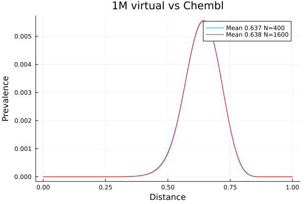

# Approximate Similarity Between Collections

`gfp_compare_collections` estimates the distribution of fingerprint distances
between two collections. It is intended for cases where the aggregate distance
profile is useful, but exhaustive pairwise output from tools such as
`gfp_lnearneighbours` would be too large or too slow to inspect directly.

A typical use case is comparing a large virtual library with a reference
collection such as Chembl. The reference collection is loaded once via `-p`; the
query collection is read as one fingerprint stream from the command line, which
may be `-` for standard input. The query stream should be randomised if it was
created by enumeration, otherwise early samples may not represent the full
library.

Both collections must contain the standard GFP components: eight `MPR`
molecular properties, a 2048-bit `FPIW` fingerprint, and equal-sized `FPMK` and
`FPMK2` fingerprints. MACCS sizes must be positive multiples of 32 bits, no more
than 256 bits, and consistent across both collections. The complete layout is
validated once, using the first reference fingerprint, and component indices
are cached for subsequent reads. All later fingerprints in both inputs are
assumed compatible; the tool does not repeat layout validation for each record.
Component tags may appear in different orders. An unsupported layout in the
first reference fingerprint is rejected rather than interpreted as standard
fingerprints.

The reference collection must already be fingerprinted:

```shell
gfp_make.sh chembl.smi > chembl.gfp
```

Then stream a randomised query collection through `gfp_make.sh`:

```shell
shuf virtual.smi | gfp_make.sh - | \
  gfp_compare_collections -h 8 -a 0.001 -f 200 -n 200 -S STEM -p chembl.gfp -
```

This avoids creating an intermediate shuffled fingerprint file. The tool accepts
exactly one query fingerprint input file or stream.

## Output

`-S <stem>` is required. Each sampling point writes a CSV file named
`<stem>0.csv`, `<stem>1.csv`, and so on. The file contains the current
normalised distribution of retained distances:

```text
Dist,Fraction
0.199,4.679843e-08
0.2,4.480701e-08
0.201,4.181988e-08
0.202,5.72534e-08
0.203,5.177699e-08
0.204,5.72534e-08
```

The distance range is divided into 1001 buckets from 0.000 through 1.000.
Bucket assignment uses `floor(distance * 1000)`: the label is the lower
edge, with distance 1.0 assigned to the final bucket. The
`Fraction` value is the fraction of all retained pairwise distances that fell in
that bucket. Distances larger than `-T` are skipped before the distribution is
normalised. Only buckets whose labels are no greater than `-T` are written.
Consequently this is a distribution conditional on the retained distances, not
the fraction of all pairs lying within the threshold.

At end of input, the final distribution includes every processed query, even
when convergence was not reached or the stream was shorter than the first
sampling point. If a scheduled sample already represents the final observations,
no duplicate file is written. Verbose output reports sample query counts and
whether processing ended through convergence or exhaustion of input.

Empty reference or query inputs, no retained distances, fingerprint parsing
errors, and failures opening or writing output files produce a non-zero exit
status.
If a sampling point has no retained distances, processing continues: later
queries may supply some. It is an error only if none were retained by EOF.
Output files are also checked against both input paths to prevent overwriting
an input, including through filesystem aliases.



In the example that generated this plot, the first sample was taken after 400
query fingerprints and another after 1600. Subsequent plots showed little
change, suggesting that the aggregate distribution had converged after a small
sample of the query collection.

## Required Options

### `-p <fname>`

Fingerprint file for the reference collection. This is commonly a corporate
collection, Chembl, or another large background set. If `-s` is not supplied,
the tool first counts the number of fingerprints in this file and uses all
of them.

### `-s <count>`

Use at most the first `<count>` reference fingerprints, avoiding the initial
counting pass. For example, `-s 10000` compares queries against the first 10,000
reference fingerprints. Reading stops at the limit; the rest of the reference
file is not examined. The value must be a positive integer.

If the file contains fewer fingerprints, all available fingerprints are used.
The allocation still reserves space for `<count>` entries, so an overestimate
wastes memory but does not add empty fingerprints to the comparisons. An empty
reference file remains an error.

This is prefix selection, not random sampling. For a representative subset,
randomise the reference order beforehand or deliberately arrange a diverse
prefix. Different limits can then be used to explore how reference-set size
affects the distribution:

```shell
gfp_compare_collections -s 10000 -p reference_random.gfp -S sample10k query.gfp
gfp_compare_collections -s 50000 -p reference_random.gfp -S sample50k query.gfp
```

### `-S <stem>`

Output stem for the sampled distribution files. Files are written as
`<stem>0.csv`, `<stem>1.csv`, etc.

## Sampling And Convergence

The first check happens after `-f <number>` query fingerprints; the minimum
allowed value is 10. If `-f` is not specified, the first check happens after
1000 query fingerprints. After each
check, the next check is scheduled `-n <number>` query fingerprints later. The
`-n` default is 1000. Batches are split at sampling points, so these counts
are honoured exactly regardless of `-b`.

At the first check there is no previous distribution, so the current distribution
is written and processing continues. Later checks compare the current
normalised distribution with the previous sampled distribution. If the selected
convergence criterion is satisfied, processing stops and the final distribution
is written.

Only one convergence criterion can be specified. If neither is specified, the
default is relative tolerance `0.01`.

### `-a <tol>`

Absolute tolerance. The distribution is converged when the absolute difference
in every bucket fraction is no greater than `<tol>`.

### `-r <tol>`

Relative tolerance. For buckets that differ, the absolute difference is divided
by the mean of the current and previous bucket fractions. The distribution is
converged only when every bucket is within `<tol>`. Buckets that were previously
zero and become non-zero prevent convergence at that check.

### `-T <dist>`

Maximum distance considered. Distances larger than `<dist>` are ignored. This is
useful when the short-distance part of the distribution is most important and
most cross-collection pairs are distant. The value must be finite, greater than
zero, and no greater than one; the default is one.

## Performance Options

### `-h <nthreads>`

Use OpenMP with `<nthreads>` threads. Each batch of query fingerprints is
compared against the reference collection in parallel.

### `-b <batch>`

Number of query fingerprints processed per batch. Batching amortizes OpenMP
threading overhead across multiple query fingerprints. The default is 10. The
final batch may be smaller, and batches are also split
when necessary to honour sampling counts. Parallel work is distributed across
queries within each batch, so a very small batch can limit useful thread
parallelism.

## Interpreting convergence

Convergence compares successive **cumulative** distributions. It measures
stability of the observed histogram, not a statistical confidence bound or a
guarantee of coverage of the full query collection. As the accumulated sample
grows, each additional fixed-size sample has less influence, even if the later
queries differ systematically. Randomising the query order is therefore
important; try different random orders or tolerances when assessing reliability.
Absolute tolerance is checked independently per bucket, rather than against a
whole-distribution error measure.

## Summary

For randomly ordered query streams, a relatively small sample can often define
the overall distance distribution well enough for collection-level comparison.
