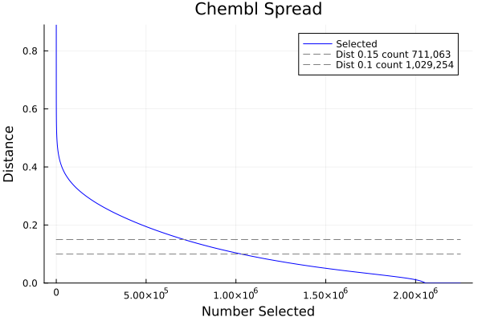

# spreadplot.py

`spreadplot.py` plots the monotonically decreasing distance trajectory produced
by a LillyMol `gfp_spread*` calculation. It reads the `sel,distance` CSV from
`nplotnn -S`, including trajectories reduced with `-X spreadreduce`. It does
not read raw spread records. The trajectory provides an intuitive
measure of the internal diversity of a molecular collection.

The script is located at [contrib/bin/spreadplot.py](/contrib/bin/spreadplot.py).

```shell
uv pip install matplotlib
spreadplot.py -S spread --dist 0.1,0.15,0.2 --summary thresholds.csv spread.csv
```

This writes `spread.png` and a threshold summary table. No LillyMol Python
bindings are needed; the script runs with the Python environment on your PATH.


## Overview

The spread tools perform greedy max/min selection. After choosing an initial
molecule, each subsequent molecule is the candidate whose distance to its
nearest previously selected molecule is greatest.

As more molecules are selected, the distance to the nearest previously selected
molecule cannot increase. The resulting trajectory therefore decreases
monotonically.

The shape of this curve characterises the collection:

- A curve that drops rapidly to low distances indicates limited internal
  diversity. For example, a collection described as 40,000 molecules might
  contain approximately 10,000 diverse structures followed by 30,000 close
  analogues of those structures.
- A curve that decreases slowly indicates a more diverse collection. Many
  molecules can be selected before a newly selected molecule is close to
  anything already selected.
- A trajectory that reaches zero indicates fingerprint duplicates. These may
  be exact duplicates or structures made equivalent by standardisation or by
  the fingerprint representation.

The result depends on the fingerprints, similarity measure, chemical
standardisation, and initial molecule used by the spread calculation. Curves
should only be compared when these choices are compatible.

The following ChEMBL trajectory includes several horizontal distance thresholds.
Each threshold shows how many molecules can be selected before the trajectory
reaches that distance.



## Workflow

First generate fingerprints and run one of the spread tools. When using the
standard LillyMol fingerprints, `gfp_spread_standard` is usually the preferred
implementation.

```shell
gfp_make.sh molecules.smi > molecules.gfp
gfp_spread_standard -h 8 molecules.gfp > molecules.spr
```

Convert the spread output to the CSV trajectory consumed by `spreadplot.py`:

```shell
nplotnn -S molecules_spread.csv molecules.spr > molecules.spr.smi
```

The CSV file contains a selection position and distance:

```text
sel,distance
0,1
1,0.87
2,0.85
3,0.83
4,0.83
```

Generate a PNG plot:

```shell
spreadplot.py -S molecules_spread molecules_spread.csv
```

This writes `molecules_spread.png`.

By default the display joins the **first position at each distinct distance
level** with straight lines. This avoids the staircase caused by rounded
distances. The final position is retained so the full trajectory extent remains
visible. This is visual interpolation only: threshold positions, summaries and
markers continue to use the original observations.

Use `--plateaus` to show the exact input polyline, retaining horizontal sections
and their abrupt drops. The numeric precision of the intermediate CSV is
controlled by `nplotnn -c N`, where N is the number of decimal places (default 2).
For example:

```shell
nplotnn -c 3 -X spreadreduce -S spread.csv molecules.spr > molecules.smi
spreadplot.py -S spread --plateaus spread.csv
```

Higher precision can produce more, finer distance levels and shorter plateaus.
It also makes threshold summaries more precise, provided those digits are
present in the original spread output. The plotter cannot recover precision
already discarded from either the spread output or the CSV.

The upper y-limit deliberately uses the **second distance**. The initial spread
distance is usually a high placeholder that would compress the useful part of
the plot. For multiple curves, the largest second distance is used. Requested
horizontal thresholds can raise that limit so that their reference lines remain
visible. An all-zero trajectory is displayed with a small positive y-range.


## Large trajectories: reduce points in nplotnn

For large selections, reduce the CSV in C++ before passing it to the plotter:

```shell
nplotnn -X spreadreduce -S molecules_spread.csv molecules.spr > molecules.spr.smi
```

`-X spreadreduce` retains the first and last row of each consecutive run with
the same **formatted distance**. Both endpoints preserve horizontal plateaus
and the drops between them exactly. Selection positions are not renumbered;
the first and last trajectory points are always retained.

The default `-c 2` provides approximately 100 distance intervals. A monotonic
trajectory in [0,1] has at most 101 formatted levels, so even a million-row
selection needs no more than 202 CSV rows after reduction. For finer resolution:

```shell
nplotnn -c 3 -X spreadreduce -S molecules_spread.csv molecules.spr > molecules.spr.smi
```

The CSV format remains `sel,distance`. The default display and first threshold crossing positions are unchanged
relative to the full CSV at the same precision. With `--plateaus`, the exact
input polyline is preserved too.
This preserves the rounded trajectory, not higher-precision distances discarded
by formatting. The plotter can continue to use the second distance for its upper
y-limit; reduction retains the information needed for that limit.

Reduction is optional and requires `-S`. Without `-X spreadreduce`, every row
is written as before. The normal SMILES output is unaffected. `-v` reports the
original and retained row counts. The current implementation still accumulates
the full distance vector in `nplotnn`; reduction saves CSV size, plotter input
processing, rendering work and vector graphics size.

## Distance thresholds

Use `--dist` to draw a horizontal reference line at a distance of interest:

```shell
spreadplot.py -S molecules_spread --dist 0.15 molecules_spread.csv
```

The legend reports the first selection position where the trajectory reaches or
falls below that distance. This makes it possible to describe the effective
size of a collection at a chosen diversity threshold. For example, if the
trajectory first reaches 0.15 after 10,000 selections, then approximately
10,000 molecules can be selected before a new molecule is within distance 0.15
of something already selected.

Multiple comma-separated thresholds can be shown on one plot:

```shell
spreadplot.py -S molecules_spread \
  --dist 0.10,0.15,0.20 molecules_spread.csv
```

Each value must be between 0 and 1. A single value remains valid, so existing
uses of `--dist` are unchanged.

## Compare collections

Supply multiple CSV files to overlay their trajectories. By default the labels
come from their filename stems; use one repeated `--label` per input to override
them. Curves use different colours automatically, or specify repeated
`--color` values:

```shell
spreadplot.py -S comparison \
  --label 'Collection A' --label 'Collection B' \
  --color green --color blue \
  --normalize --dist 0.15,0.20 --summary comparison.csv \
  collection_a.csv collection_b.csv
```

`--normalize` plots `(sel + 1) / (last_sel + 1)`, expressed as a percentage.
It accounts for the zero-based selection positions and works with reduced CSVs
because their final positions are retained. It normalizes each trajectory to
the length of its represented selection sequence; it does not infer the size
of an original fingerprint pool if selection stopped early.

`--logx` uses a logarithmic x-axis to reveal early changes in large collections.
Without normalization, position zero is omitted from rendering because it cannot
appear on a log axis. Threshold calculations still use all input observations.

## Threshold summary CSV

`--summary filename.csv` writes one row for each curve and requested `--dist`
threshold. The columns are:

| Column | Meaning |
| --- | --- |
| `file` | Input CSV filename, or `-` for stdin |
| `label` | Curve label |
| `threshold` | Requested distance |
| `status` | `crossed`, `at_start`, or `not_reached` |
| `sel` | First observed zero-based position at or below the threshold |
| `fraction_selected` | `(sel + 1) / (last_sel + 1)` |

An unreached threshold has blank position and fraction fields. `at_start`
means that the first observation already satisfies the threshold; it is not
reported as a later crossing. Positions are observations, not interpolated
estimates or molecule counts. The same results appear in plot legends.

`--summary` requires `--dist`. Use `--summary -` to write the table to stdout.
Input files cannot be overwritten by either output.

## Options

### `-S stem`

Required. Specifies the output filename stem. The extension selected by
`--format` is appended.

```shell
-S results/spread
```

With the default format this writes `results/spread.png`.

### `--dist distances`

Draw one or more horizontal distance thresholds. Supply multiple values as a
comma-separated list. Each legend entry includes the threshold and the first
selection position at which it is crossed.

```shell
--dist 0.15
--dist 0.10,0.15,0.20
```

### `--title title`

Set the plot title.

```shell
--title 'Internal diversity of screening collection'
```

### `--label label`

Set the legend label. The default is `Selected` for one input, or the filename
stem for each of several inputs. Repeat this option once per input when
supplying custom labels for multiple curves.

```shell
--label 'ChEMBL 33'
```

### `--lwd width`

Set the width of the trajectory line. The default is `4`.

```shell
--lwd 6
```

### `--color colour`

Set the trajectory colour using a Matplotlib colour name or code. The default
for one curve is `green`; multiple curves use Matplotlib's colour cycle.
Supply one colour for all curves or repeat the option once per input.

```shell
--color blue
```

### `--format format`

Set the output graphics format. The default is `png`. The filename is formed as
`stem.format`.

```shell
--format svg
```

Supported formats are `png`, `svg` and `pdf`. Rendering is headless and does
not require a display.

### `--spline npoints`

Use monotonic piecewise cubic interpolation and plot `npoints` samples
through the displayed distance levels. With `--plateaus`, all input observations
are used as interpolation knots instead. At least two samples are required.
Choose `npoints` at least as large as the number of input datapoints to avoid
losing detail. After reading the datasets, the script warns for each input with
more rows than the requested sample count; plotting continues. This comparison
uses input rows, including plateau endpoints, rather than the original selection
count represented by a reduced file.

SciPy is imported only when this option is requested. Use `nplotnn -X spreadreduce`
for point reduction, and `--spline` when a finer interpolated display is wanted.

```shell
--spline 5000
```

The interpolation changes the rendered curve, but distance-threshold counts and
point markers are still calculated from the input trajectory. For a monotonic
curve, `nplotnn -X spreadreduce` usually avoids the need for spline interpolation
while retaining the information needed for either the default display or the
exact `--plateaus` display.

### `--point delta`

Place markers on the trajectory at regular distance intervals. For example,
`--point 0.1` adds markers near the crossings of 0.9, 0.8, 0.7, and so on.

```shell
--point 0.1
```

### Dimensions and resolution

`--width` and `--height` specify inches (defaults 10 and 6).
`--dpi` controls PNG resolution (default 150). For example:

```shell
spreadplot.py -S presentation --width 12 --height 7 --dpi 200 trajectory.csv
```

### Standard input

Use `-` once among the input filenames:

```shell
cat trajectory.csv | spreadplot.py -S spread --dist 0.15 -
```

Inputs require the `sel` and `distance` header columns and at least two rows.
Positions must be non-negative, strictly increasing integers. Distances must
be finite, in [0,1], and monotonically non-increasing. Extra columns are allowed;
missing values and malformed CSV records are errors.

## Complete example

```shell
gfp_make.sh collection.smi > collection.gfp
gfp_spread_standard -h 8 -r 10000 collection.gfp > collection.spr
nplotnn -X spreadreduce -S collection_spread.csv collection.spr > collection.spr.smi
spreadplot.py \
  -S collection_diversity \
  --title 'Collection internal diversity' \
  --label 'Collection' \
  --dist 0.10,0.15,0.20 \
  --point 0.1 \
  --summary collection_thresholds.csv \
  --color blue \
  --lwd 5 \
  collection_spread.csv
```

The result is written to `collection_diversity.png`.

## Requirements

Python 3.10 or later and Matplotlib are required. SciPy is optional and is used
only with `--spline`. CSV parsing and argument handling use the standard library;
pandas and LillyMol bindings are not required.

For a uv-managed environment:

```shell
uv pip install matplotlib
uv pip install scipy  # optional, for --spline
```

Or with pip:

```shell
python3 -m pip install matplotlib
python3 -m pip install scipy  # optional
```

## Testing

From the repository root:

```shell
python3 contrib/bin/test/spreadplot_test.py
```

The tests cover full/reduced CSV inputs, threshold crossings, the deliberate
second-distance y-limit, overlays, normalization, log axes, monotonic
interpolation and temporary PNG, SVG and PDF output. The interpolation tests
require SciPy.

The original [Julia script](/contrib/bin/spreadplot.jl) and its tests remain
available for existing users; Python is the recommended interface.

See [gfp_spread](/docs/GFP/gfp_spread.md) for details of spread selection,
available implementations, first-molecule selection, stopping criteria, and
fingerprint weighting.
