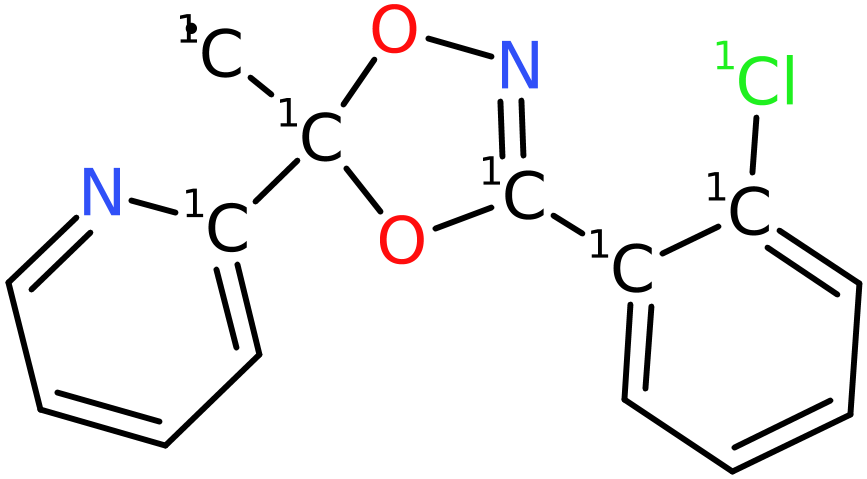
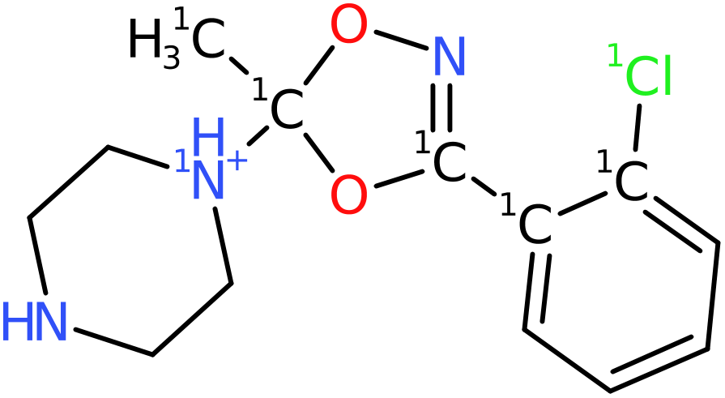

# SAFE

The idea for the SAFE smiles representation was proposed by 
```
Gotta be SAFE: A New Framework for Molecular Design
Emanuel Noutahi, Christian Gabellini, Michael Craig
Jonathan Lim, Prudencio Tosou. Valence Labs.
https://arxiv.org/pdf/2310.10773.pdf
```
and LillyMol has a tool, `mol2SAFE` that can convert a normal
smiles file to a SAFE type smiles file.

As a reminder the fundamental principle behind the SAFE method is the observation
that
```
C1.C1
```
is a valid smiles for ethane. A Carbon atom with ring opening 1. Not a bond.
A Carbon with ring closing number 1. Ethane. And of course any ring
number can be used. In this case, we use ring openings and closings larger
than 10 to avoid interfering with existing ring openings and closings.

Typical SAFE smiles for more complex molecules might look something like
```
[1C]%10.[1C]%11.[1O]%10%12.[1N]%13(=O)=O.[1C]%131=[1C]%11C2=C(O1)C=[1C]%12C=C2 CHEMBL7372
[1O]%10.[1O]%11.[1O]%12.[1O]%13.[1C]%10%14.O1[1C]%14[1C]%11CO[1P]%12(=O)O[1P]%131=O CHEMBL1162462
[1N]%10%11%12.[1C]%12.[1C]%13%10.[1C]%13#C.[1C]%11(C)[1C]%14.[1C]%141=CC=CC=C1 CHEMBL8663
[1C]%10%11.[1N]%12%10.N#[1C]%13.[1C]%12CC.[1C]%131=CC=C[1C]%11=C1 CHEMBL14007
[1C]%10.[1C]%11.[1O]%12[1S]%10(=O)=O.[1N]%121C(=O)[1C]%11CC1=O CHEMBL11688
[1Cl]%10.[1Cl]%11.[1C]%12%13.[1N]%14%12.[1C]%14C.[1C]%101=[1C]%13C=C[1C]%11=C1 CHEMBL13547
[1N]%10%11.[1Cl]%12.[1Cl]%13.[1C]%11%14.[1C]%10C.[1C]%141=[1C]%12C=C[1C]%13=C1 CHEMBL13562
```
where `%nn` ring opening and closing features have been added in order
to rebuild the molecule.

The fundamental idea behind the methodologies outlined here is the idea that SAFE fragments
can be interchanged with others, just by adjusting the ring numbers. So if the starting
fragment includes ring number `%12` then another SAFE fragment with just one ring number
can be substitued, as long as its ring number is converted to `%12`. Similarly for
SAFE fragments with two join points, etc. These string operations are cheap.

The tools outlined below can impose constraints on other aspects of any proposed
change based on swapping a SAFE fragment.

## De-Novo Generation
There are thre modes of operation:

1. Replace a SAFE fragment with a random fragment from a library.
2. Replace a SAFE fragment with each plausible fragment from a library.
3. Replace a SAFE fragment with a fragment from another molecule.

All involve first running mol2SAFE in order to generate the SAFE representations.

During testing, the following invocation seemed useful.
```
mol2SAFE -v -c -l -I 1 -S chembl.lib.textproto -M 16 -M maxnr=9 -g all -z -T I=Cl -T Br=Cl chembl.smi > chembl.safe.smi
```
Takes less than 3 minutes to process a recent version of Chembl.

The usage message for mol2SAFE is
```
Transform smiles to SAFE representations.
 -p             write the parent molecule as well
 -c             remove chirality
 -l             strip to largest fragment
 -y             re-use ring numbers in generated ring numbers
 -I <iso>       place a fixed isotope on all attachment points
 -P <atype>     atom typing specification. If specified the isotope will be the atom type.
 -Q <query>     never break bonds between matched atoms; repeatable, SMARTS:... allowed
 -k <iso>       never break a bond when both endpoints already have isotope <iso>
 -S <fname>     write fragment statistics in dicer_data::DicerFragment textproto form
 -M ...         constraints on max fragment size
 -M <n>         fragments can contain no more than <n> atoms
 -M maxnr=<n>   the maximum number of non-ring atoms that can be in a fragment
 -M maxringsys=<n>  optionally limit rings per ring system, including spiro fusions,
                   and verify SAFE ring numbering; disabled by default.
 -g ...         standardisation options
 -z             ignore connection table errors on input
 -T ...         Element transformations - suggest '-T Br=Cl -T I=Cl'
 -t             test the unique smiles of the parent against that formed from the SAFE representation.
                This only works if chirality is removed and isotopes NOT added.
 -v             verbose output
```

In the invocation above, input is stripped to the largest fragment, chirality is removed,
chemical standardisation is applied, and a common Halogen transformation is applied. We
limit ourselves to fragments with a maximum of 16 heavy atoms, of which a max of 9 can be
non ring atoms.

### Preserve a labelled region or matched bonds

Use `-k ISO` to protect a bond when **both endpoints already carry isotope ISO**:

```shell
mol2SAFE -k 13 -I 1 -S library.textproto labelled.smi > labelled.safe.smi
```

Bonds within a region labelled with isotope 13 remain intact. A boundary bond
with only one labelled endpoint can still be cut. A bond between isotope 13 and
a different isotope is not protected by this shortcut. ISO must be a single
positive isotope number; omitting `-k` disables the shortcut.

This uses a direct isotope comparison on candidate bonds in the shared
`MoleculeFragmenter`. It performs no substructure search and allocates no extra
per-atom protection array.

For more general patterns, the fragmenter's existing repeatable `-Q` option
accepts query files and the standard `SMARTS:` form:

```shell
mol2SAFE -Q protect.textproto -Q 'SMARTS:COC' -I 1 \
  -S library.textproto input.smi > input.safe.smi
```

For every embedding, **all bonds between matched atoms** are protected. This is
the shared fragmenter's existing behavior, rather than a first-two-atoms-only
rule. For example, `COC` protects both C–O bonds. A two-atom query can identify a
single bond. Additional query atoms also participate in protection, not just as
context. Embeddings with fewer than two atoms protect no bonds.

Exclusions supplement the default fragmentation rules. Queries that match
nothing leave normal fragmentation unchanged. Multiple `-Q` queries and
`-k` may be combined: either protection prevents a cut, including cuts nominated
by the fragmenter's CF3 rule.

Protection is evaluated **after preprocessing and before any bonds are removed
or attachment isotopes are assigned**. Consequently, new labels from `-I` or
`-P` cannot accidentally protect later candidate cuts. The protected region's
original labels are retained on unmodified atoms, but a boundary atom participating
in an allowed cut can have its isotope overwritten by the attachment label.
Prefer distinct region and attachment isotope values when using the result
with `safe_generate -j`.

The resulting components are used for both SAFE output and fragment-library
statistics. If no cuts remain, the molecule is skipped, as for other inputs with
no breakable bonds. `-v` reports how many remaining candidate bonds were protected
by the isotope shortcut, after query exclusions.

These options preserve bonds during `mol2SAFE` conversion. They do not mark a
fragment as immutable during subsequent `safe_generate` replacement; use that
tool's own `-Y`/`-N` restrictions when necessary.

### Optional complexity and ring-number checks

For unfamiliar or potentially complex inputs, enable the optional producer checks:

```shell
mol2SAFE -I 7 -M maxringsys=7 -S library.textproto input.smi > input.safe.smi
```

After preprocessing, `-M maxringsys=N` skips molecules whose ring systems contain
more than N SSSR rings. **Spiro-connected rings belong to the same system.**
The limit is inclusive: seven rings are permitted with `maxringsys=7`.
It applies separately to each system, rather than to the total ring count.
N must be positive.

This qualifier also checks the generated fragments and SAFE output: ordinary
internal ring closures must use single-digit labels, while SAFE connection
labels must remain in the range 10–99. The check examines the actual rendered
output so that an internal ring label cannot collide with a SAFE connection.
A molecule rejected by any of these checks contributes neither SAFE output
(including optional parent output) nor fragment-library statistics. Processing
continues with the next molecule; `-v` reports separate counts for excessive
ring systems and unsafe numbering.

All these additional checks are **disabled by default**. If the inputs are known
to be small, no ring-system labelling array, system ring counting, or additional
fragment/SAFE numbering verification is performed. This preserves the original
fast path, but assumes that the caller supplies molecules within the supported
numbering convention.

The file `Sfile` is a textproto file with a summary of the fragments found. This file can be
used as input as a library file (-L option) to `safe_generate`. For Chembl, it contains about 91k molecules.

In a lead optimisation scenario, it would make sense to build a fragment library
from active molecules, and then feed all active molecules to safe_generate in order to
generate molecules where likely active fragments get combined across product
molecules.

The library file generated with the -S option is a textproto file and might look like
```
iso: ATT smi: "C12=C(C=[1CH]C=[1CH]1)CNC(=O)O2" par: "CHEMBL162861" n: 1 
iso: ATT smi: "[1CH]1=[1CH]C=C2[1CH]=C3C(=CC2=C1)[1CH2]OC3=O" par: "CHEMBL512822" n: 1 
iso: ATT smi: "C12=C([1CH]=C[1CH]=[1CH]1)CC[1CH2]2" par: "CHEMBL62102" n: 44 
iso: ATT smi: "N1=[1CH]N=C2[1NH]C3=C([1CH]=C2C1=O)C=CC=C3" par: "CHEMBL484575" n: 12 
iso: ATT smi: "[1CH2]1C2=C(CCC3=C1C=CC=C3)C=CC=N2" par: "CHEMBL64593" n: 4 
iso: ATT smi: "C12=C(C(=O)[1NH]C(=O)[1NH]1)N1C=C[1CH]=CC1=N2" par: "CHEMBL112098" n: 43 
iso: ATT smi: "C12(CCCCC1)NC(=O)C1=C(C3=CC=[1CH][1CH]=C3[1NH]1)[1CH2]2" par: "CHEMBL1945341" n: 1 
iso: ATT smi: "N1C(=O)C2(C3=C1C=C[1CH]=C3)ON=[1CH][1NH]2" par: "CHEMBL3797426" n: 16 
iso: ATT smi: "C1[1CH]=CC2C(=C1)[1CH2]CC[1CH2]2" par: "CHEMBL3983484" n: 1 
```
where the "par" field holds the name of the first molecule encountered that generated
this fragment, and "n" is the number of instances found across all of Chembl. Isotopes
mark the attachment points.

## safe_generate
Once a SAFE fragment library file has been built, and/or the input set of molecules
converted to SAFE form, safe_generate can be run. Configuration via a textproto config
file is preferred.
```
safe_generate -p -e 2000 -b 3000 -n 1000 -C generate.textproto -v -L chembl.lib.textproto input.safe.smi
```
### Attachment isotopes and other molecular labels

When input molecules have isotopes unrelated to fragment attachment, use
`safe_generate -j <iso>` to recognise only that isotope as an attachment marker.
**This must be the same value passed to `mol2SAFE -I <iso>`**, both when building
the fragment library and when preparing the SAFE input molecules.

```shell
mol2SAFE -I 7 -c -S library.textproto molecules.smi > molecules.safe.smi
safe_generate -j 7 -I -e 0 -L library.textproto molecules.safe.smi > products.smi
```

Only atoms labelled with isotope 7 are counted as attachment points or used to
calculate attachment distances. Other isotopes, such as 13 or 15, remain ordinary
molecular labels and are preserved in generated SMILES. With `-j 7 -I`, only the
attachment isotope 7 is removed from product SMILES. Without `-I`, attachment
labels are retained too. SAFE output (`-s`) retains its connection markers and
isotopes so that it can be used as input for another generation step.

Choose an attachment isotope absent from the original molecular labels.
`mol2SAFE` overwrites any original isotope on an attachment atom, so that label
cannot be recovered by `safe_generate`. If `-j` is omitted, the original behavior
is retained: every nonzero isotope denotes an attachment and `-I` clears all
product isotopes. Zero is not a valid explicit attachment isotope.

The -n option specifies up to 1000 variants by replacing SAFE fragments with randomly
selected fragments from the library - mode #1.

The -e option specifies making at most 2000 accepted variants per input molecule
per library by replacing SAFE fragments with plausible library fragments - mode #2.
The allowance starts again for each library. Use `-e 0` for unlimited enumeration.
Rejected candidates and duplicate products do not consume the allowance.

The -b option specifies generating as many as 3000 molecules by swapping SAFE
fragments between molecules - the library is not used. Mode #3.

The textproto config file is specified by the -C option, and might look like 
```
max_atoms_in_fragment: 10
extra_atoms: 2
fewer_atoms: 2
extra_rings: 1
max_formula_difference: 3
max_distance_difference: 2
molecule_filter {
  max_natoms: 40
  max_nrings: 5
  max_rotatable_bonds: 10
  min_aromatic_ring_count: 1
  max_aliphatic_ring_count: 2
}
```
Only fragments with at most 10 atoms will be processed. Once a fragment is selected for
replacement, the library fragment, or fragment chosen from another molecule, must differ
by at most two atoms (atom count). Additionally, the new fragment can have an extra ring - but this
might be hard with only two additional atoms. These two parameters are related.

Each omitted atom-count allowance defaults to zero. With neither
`extra_atoms` nor `fewer_atoms` specified, replacements must have the same atom
count as the fragment removed. Specifying only `extra_atoms` allows growth but
not shrinkage, and vice versa. The `-x extra=N` and `-x fewer=N` options set the
corresponding atom-count allowances.

The `extra_rings` and `fewer_rings` fields limit increases and decreases in the
number of SSSR rings; an omitted ring-count allowance imposes no limit.
`max_increase_ring_size` and `max_decrease_ring_size` limit changes in the
largest SSSR ring size, using zero for a fragment without rings.

The `max_formula_difference` specification is unusual. An aromatic molecular formula
is computed for each fragment: it contains the number of aliphatic Carbon and aromatic
Carbon atoms, etc. In order for a fragment swap to occur, the total absolute difference in 
the two formulae must be 3 or fewer. This could be a difference of 3 in just aliphatic
Oxygens, or differences spread across atom types.

The `max_distance_difference` is only used on fragments with more than
1 connection.  Fragments with more than one connections have a
distance attribute - the shortest bond separation distance between
connection points. The `max_distance_difference` attribute governs by how much
the distance attribute can change when fragments are swapped. Again, a smaller number
will enforce more similar structures being formed.

Then follows specification of the molecule filter that is applied to the product
molecules before writing.

### Candidate selection and input requirements

Exhaustive generation tries each library fragment at **every eligible source
fragment** with the same number of connections. This can generate more products
than older versions, which tried only one source fragment per library entry.
Atom-count, ring-count, ring-size, formula and attachment-distance constraints
apply to each proposed replacement. The minimum and maximum fragment atom counts
apply to both source and replacement fragments in every generation mode.

`-Y` selects source fragments containing query matches; `-N` excludes fragments
containing matches. The same eligibility restrictions are applied when choosing
breeding donors. An unmatched `-Y` query set is fatal unless `-z i` is specified,
in which case that parent is skipped and processing continues. These are
fragment-level restrictions: matching one atom selects or protects its entire
fragment.

Random generation (`-n`) requires a nonempty library. Breeding (`-b`) requires at
least two retained input molecules. Unsupported `atom_type` and `etrans` config
fields cause an error. Apply preprocessing and element transformations to the
starting molecules with `mol2SAFE`; `safe_generate` rejects `-l`, `-c`, `-g`
and `-T`, which older versions accepted without applying them. Changing the graph
after conversion requires rebuilding its SAFE encoding.

The existing undesirable-adjacency check is now enforced: candidates containing
adjacent heteroatoms connected by a non-aromatic single bond, or non-aromatic
carbon–halogen single bonds, are rejected. This check examines the whole product,
including unchanged regions. The separate attachment-bond checks also apply.

Duplicate detection stores accepted products only, and normalizes attachment
isotopes first when `-I` is specified. Products differing only in attachment
labels removed from the output are therefore written once. Ordinary isotopes
remain significant when `-j` is used. `-p` writes retained parents once before
variants in all generation modes, in their original SAFE form.

`safe_generate` assumes that ordinary internal ring closures use single-digit
labels and that `%nn` labels denote only SAFE connections. Unsupported internal
two-digit closures are rejected when loading a fragment or library.
There is no per-molecule reserved-label table or per-replacement internal-ring
renumbering pass. Use `mol2SAFE -M maxringsys=7` to verify the producer contract
when needed. The extended `%(nnn)` ring-number syntax is unsupported.

Isotopic labels still cannot describe how many severed bonds belonged to a
single atom in a library fragment. Multiple attachments on one atom remain a
known representation limitation.

Given an input file with 200 molecules, the invocation above generates
almost 50k molecules in 36 seconds.

There is no recursion built into safe_generate, but if SAFE smiles are written,
-s, then the output from one invocation can be fed to another, which has the
advantage of seamlessly using multiple cores. But since the two processes are
separate, duplicate detection is not robust. Adding recursion would add
code complexity, and is not a priority now.

For a given set of molecules, it might be hard to anticipate the maximum
number of candidates that can be generated. Usually the available fragments
are generated fairly quickly, so we can end up with the unfortunate
situation of having asked for (say) 100k new molecules, but after a few
seconds, no more will be found. The -k option says that if a sequence
of unsuccessful attempts longer than the -k option is encountered,
abandon random generation for that parent, or the breeding loop. The cutoff
counts consecutive failed attempts and resets after each accepted product;
`-k 0` disables it. It does not affect exhaustive enumeration.

So something like
```
safe_generate -n 100000 ... -k 2000 input.safe.smi
```
might be desirable.

The full usage message is
```
Denovo generation of molecules from SAFE smiles.
Consumes the output from mol2SAFE, and the -L file is also from mol2SAFE.

mol2SAFE ... -S library.textproto file.smi > file.safe.smi
safe_generate ... -L library.textproto -C generate.config file.safe.smi > new_molecules.smi

 -C <fname>             safe_generate textproto configuration file.
 -a <ncon>              maximum value for number of connections processed - applied to library.
 -L <fname>             fragment library of SAFE fragments
 -j <iso>               recognise only this isotope as an attachment point.
                        Must match the -I value used with mol2SAFE; preserve other isotopes.
 -I                     remove product isotope labels; with -j, remove only attachment labels.
 -Y <query>             queries for atoms that are allowed to change
 -N <query>             queries for atoms that are NOT allowed to change
 -z i                   ignore molecules not matching queries
 -x extra=<n>           the number of extra atoms in a fragment being substitued
 -x fewer=<n>           the number of fewer atoms in a fragment being substitued
 -n <n>                 number of molecules to generate by fragment swap from library
 -b <n>                 number of molecules to generate by breeding
 -e <n>                 for each molecule, exhaustively scan the library(s) making all possibilities.
                        Write at most <n> accepted variants per input molecule per library.
                        Use '-e 0' for no limit.
 -F <fname>             molecule filter textproto file - products must pass
 -p                     write the parent molecule before variants
 -s                     write SAFE smiles
 -k <number>            abandon if no new molecules formed for <number> steps
 -v                     verbose output
```

In addition to the fragments found during conversion from smiles to SAFE
you can add other fragments to the library. For example, to use some dicer
fragments something like

```bash
dicer_fragments_collate -p 10 -nosmi -v \
        ${LILLYMOL_HOME}/data/dicer_fragments/FRAG_1_[1-5].textproto > frag.textproto

fileconv -S - frag.textproto | mol2SAFE -I 1 - > frag.safe.smi
```
and then add that as another -L option to safe_generate.

## Examples
Given

 

and CHEMBL493334, the molecule



can be formed with the config file above. In this case
the transformation is rather simple, an aromatic ring
swapped for an aliphatic ring of the same size, but many more
possibilities are available - that molecule generated over
200 different variants, consistent with the configuration file.

## Interesting Features
Given that the path through a molecule is arbitrary, something
like an amide fragment can equally likely appear as `[1N]%11[1C](=O)%12` or
as `[1C]%11(=O)-[1N]%12`, which means that if both are present in a 
fragment library, then bidirctional amide formation will be observed.
Note that even if unique smiles are used, there will still be
arbitrary numbers of amide SAFE fragments in either direction.

Since mol2SAFE does not break ring bonds, the results will never
contain unprecedented rings. The tool does make efforts to discard
obviously bad bonds being formed - peroxides for example.

## Summary
`safe_generate` can reasonably quickly generate quite reasonable
looking molecules. It is highly likely that the results would need
to be sent to some kind of post-processing filtering - Lilly Medchem
Rules for example. And/or set query specifications in the
`discard_if_match` attribute in the config file in order to specify
specific queries specifying product molecules to be discarded. Note
that it takes the same syntax as the -q option to `tsubstructure`
so an entry like
```
  discard_if_match: "SMARTS:[CH]=O"
```
could be used to discard aldehydes in products - some care has been taken to
minimise this, but some do make their way through.

There is no correct specification for the entries in the config file.
Allowing only small differences will result in a 'conservative' set
of new molecules, where the differences from the starting molecules
are small. Large values will see more diverse molecules generated.
Conservative changes should maximise the ability of a QSAR model
to make valid predictions.

## Thoughts
Given the above, and the fact that it is all implemented in C++, the
obvious question arises, why not just process the fragments as
Molecules, and forget the whole SAFE thing - that would clearly
be more efficient. Indeed that is planned, and some of the
infrastructure built here will be re-used. Part of the point of
building this tool was to demonstrate the viability of the
SAFE concept for de-novo molecule construction.
